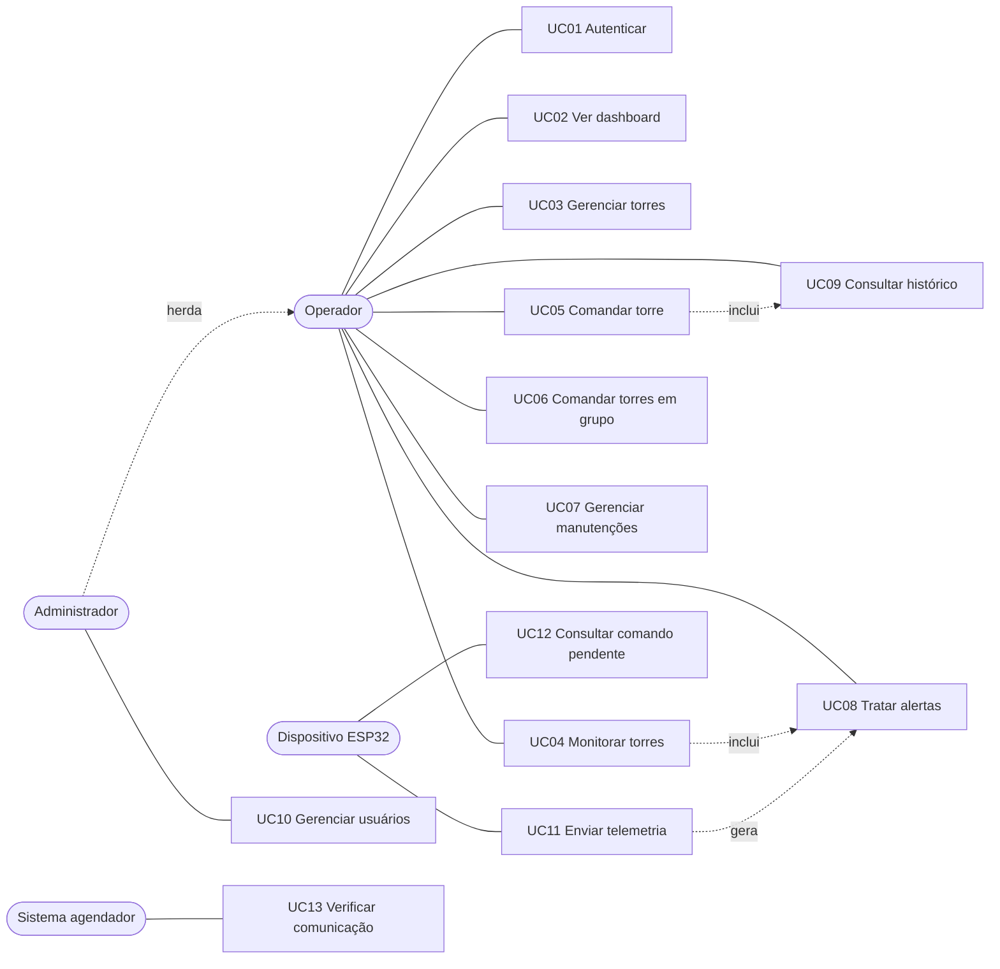

# Casos de Uso

## Atores

- **Operador**: acompanha e controla a operação.
- **Administrador**: tudo do operador, mais a gestão de usuários.
- **Dispositivo (ESP32)**: envia telemetria e busca comandos.
- **Sistema (agendador)**: verifica ausência de comunicação e limpa leituras antigas.

## Visão geral

## Descrição dos principais casos

### UC01 Autenticar
- **Ator:** operador ou administrador. **Pré-condição:** usuário ativo cadastrado.
- **Fluxo principal:** informa e-mail e senha; o sistema valida, gera o token e leva ao Dashboard.
- **Alternativo:** credenciais inválidas ou usuário desativado: mensagem "E-mail ou senha inválidos" (401).
- **Regra:** rotas do painel exigem token; sem ele o usuário volta ao login.

### UC03 Gerenciar torres
- **Fluxo principal:** o operador cadastra, edita ou exclui uma torre; pesquisa por nome ou código; filtra por status e setor.
- **Alternativos:** código já usado (400); setor inexistente (404); dados inválidos (400).
- **Regras:** combustível só vale para fonte Gerador; ao salvar, níveis baixos geram alerta; excluir remove alertas, manutenções e leituras da torre, mas preserva o histórico.

### UC04 Monitorar torres
- **Fluxo principal:** abre Monitoramento; vê as torres ordenadas por gravidade (Crítico, Alerta, Manutenção, Normal); filtra por indicador; abre uma torre para ver detalhes.
- **Regra do indicador:** Manutenção se em manutenção; Crítico se indisponível ou com alerta crítico ativo; Alerta se houver outro alerta ativo; senão Normal.

### UC05 Comandar torre
- **Pré-condição:** torre fora de manutenção.
- **Fluxo principal:** escolhe um comando; o sistema pergunta, por exemplo, "Confirmar ativação do modo de intensidade máxima na Torre 04?"; ao confirmar, o backend aplica, persiste e registra no histórico com o usuário.
- **Alternativos:** operador cancela (nada acontece); torre em manutenção (400).
- **Pós-condição:** se a torre tem dispositivo conectado, o comando entra na fila de comandos pendentes.

### UC06 Comandar torres em grupo
- **Fluxo principal:** seleciona várias torres (ex.: todas do Setor Norte filtrando por setor e marcando todas); escolhe o comando; confirma; o backend aplica a cada torre e informa quantas foram alteradas e quais foram ignoradas.

### UC07 Gerenciar manutenções
- **Fluxo principal:** abre manutenção (preventiva ou corretiva) com descrição, responsável e data prevista. Com "iniciar agora", a torre passa a "Em manutenção". Ao concluir, o operador escolhe devolver a torre à operação.
- **Alternativos:** manutenção concluída ou cancelada não pode ser editada (400); cancelar devolve a torre.

### UC08 Tratar alertas
- **Fluxo principal:** consulta alertas ativos ou resolvidos, filtra por nível e marca como resolvido.
- **Origem dos alertas:** automática (bateria, combustível, sem comunicação) ou manual (falha técnica registrada no painel da torre).

### UC10 Gerenciar usuários (administrador)
- **Fluxo principal:** cria e edita usuários, define perfil, ativa ou desativa, redefine senha.
- **Regra:** o administrador não pode desativar nem rebaixar a própria conta.

### UC11 Enviar telemetria
- **Fluxo principal:** o ESP32 envia `torreId`, luminosidade, bateria e estado com a chave de API; o sistema valida a torre, grava a leitura, atualiza bateria, estado e última comunicação, gera alertas se necessário e resolve o alerta de "sem comunicação".
- **Alternativos:** chave ausente ou inválida (401); torre inexistente (404).
- **Regra:** se houver comando pendente, o estado informado pelo dispositivo é ignorado para não desfazer o comando do operador.

### UC12 Consultar comando pendente
- **Fluxo principal:** o ESP32 consulta `GET /api/iot/torres/{id}/comando`; recebe 200 com o comando mais antigo (marcado como entregue) ou 204 se não houver.

### UC13 Verificar comunicação
- **Fluxo principal:** a cada 60 s o sistema procura torres com dispositivo e sem telemetria há mais de 5 min e cria alerta "Sem comunicação" (atenção), uma única vez por torre.
