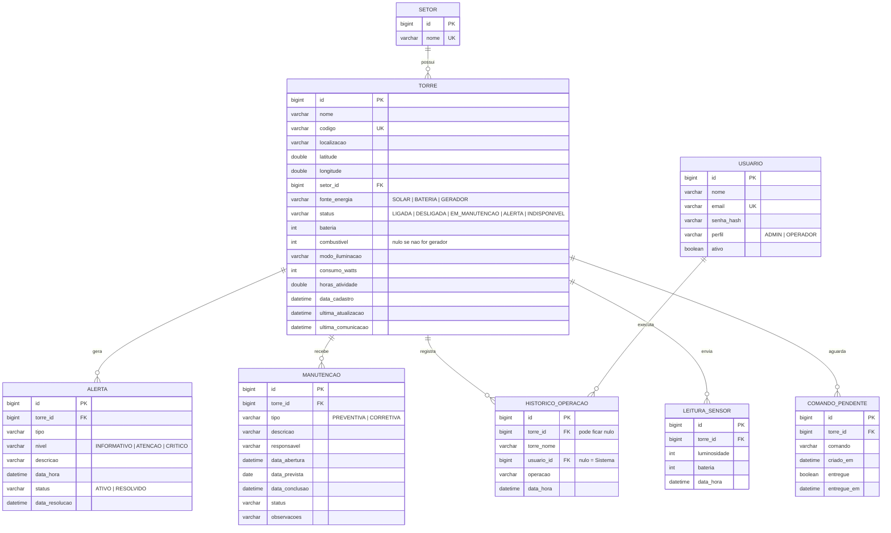

# Modelo de Dados (DER)

## Decisões

- **`HISTORICO_OPERACAO.torre_nome`** guarda o nome no momento da operação. Assim o histórico continua legível mesmo que a torre seja excluída (nesse caso `torre_id` fica nulo).
- **`usuario_id` nulo** indica operação feita pelo sistema (alertas automáticos, telemetria).
- **`consumo_watts` e `horas_atividade`** permitem estimar consumo e tempo de atividade no Dashboard sem tabela extra.
- **`COMANDO_PENDENTE`** é a fila do polling do ESP32; ela é criada somente para torres que já enviaram telemetria.
- O esquema é gerado pelo Hibernate (`ddl-auto: update`). Em produção, o ideal é adotar migrações (Flyway).
