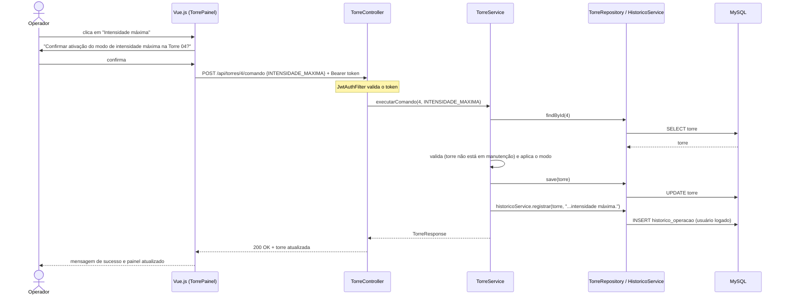
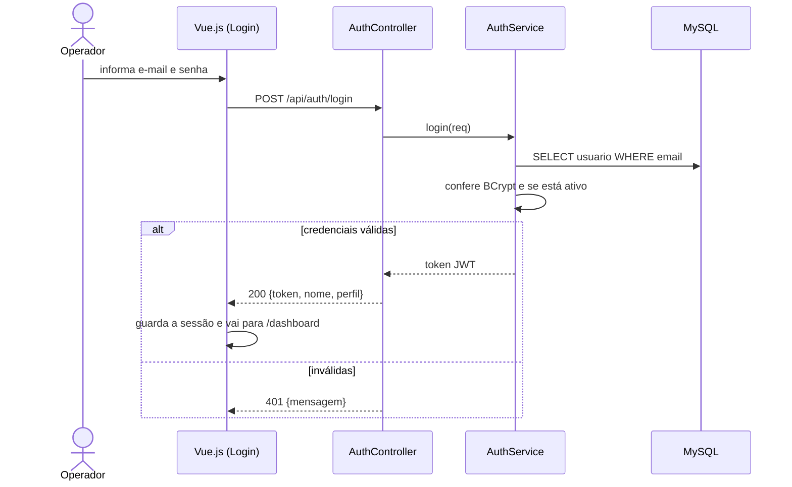
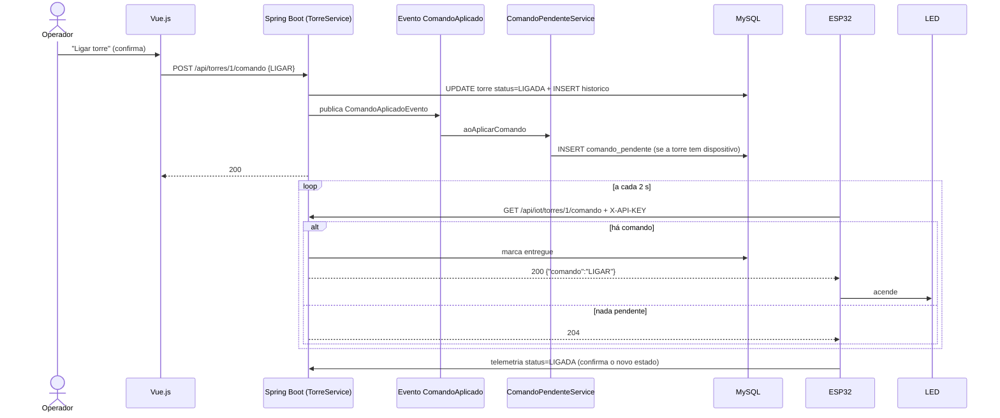
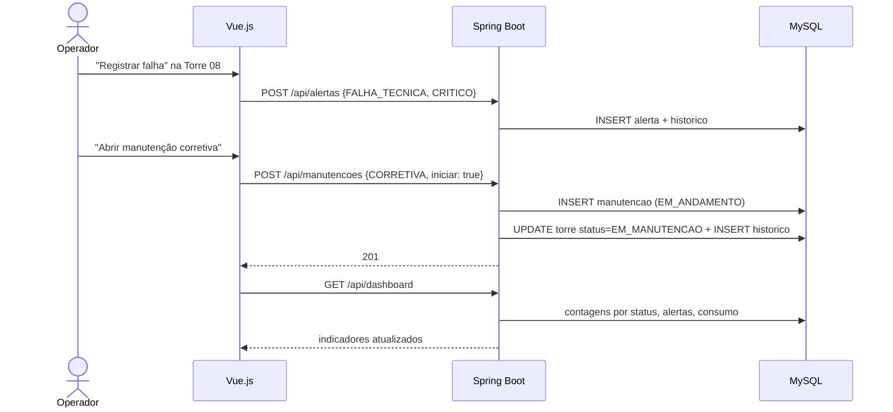

# Diagramas de Sequência

## 1. Operador comanda uma torre (fluxo principal)

Operador > Vue.js > Spring Boot > Service > Repository > MySQL.



## 2. Login



## 3. IoT: ESP32 envia telemetria

ESP32 > API Spring Boot > Banco de Dados.

```mermaid
sequenceDiagram
    participant Esp as ESP32
    participant Key as IotApiKeyFilter
    participant Api as IotController
    participant Svc as TelemetriaService
    participant Alt as AlertaService
    participant DB as MySQL

    Esp->>Key: POST /api/iot/telemetria {torreId, luminosidade, bateria, status} + X-API-KEY
    alt chave inválida
        Key-->>Esp: 401
    else chave válida
        Key->>Api: segue
        Api->>Svc: registrar(req)
        Svc->>DB: SELECT torre
        alt torre não existe
            Svc-->>Esp: 404
        else existe
            Svc->>DB: INSERT leitura_sensor
            Svc->>DB: UPDATE torre (bateria, última comunicação, estado se permitido)
            Svc->>Alt: verificarNiveis(torre) e resolver "sem comunicação"
            Alt->>DB: INSERT/UPDATE alerta
            Svc-->>Esp: 200 {status, modo, comandoPendente}
        end
    end
```

## 4. Caminho inverso: operador liga a torre e o LED acende



## 5. Falha técnica e manutenção corretiva


